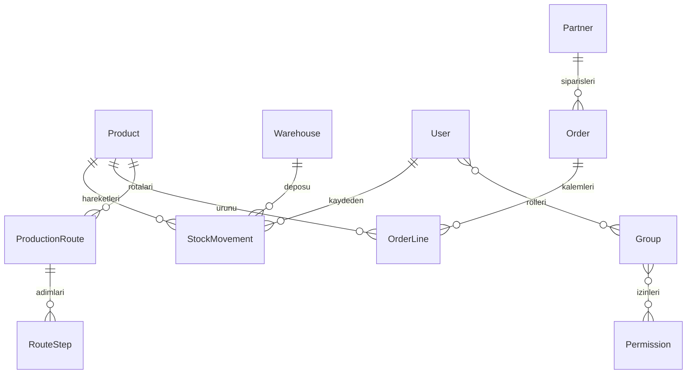

# Teknik yapı

## Neden bu teknolojiler?

Django 5.2 LTS, giriş, oturum, CSRF koruması, parola doğrulama, Türkçe yönetim ekranı ve kullanıcı/grup izinlerini birlikte sağlar. Sunucuda oluşturulan HTML ve sade CSS, ayrı bir ön yüz derleme zinciri gerektirmez. Mobil düzende menü yatay kayar; geniş tablolar kendi alanında kaydırılır. Para ve miktar alanlarında ondalık sayılar kullanılır; kayan nokta yuvarlama hatalarından kaçınılır.

## Veri tabanı

- Ürün: kod (benzersiz), ad, birim, asgari stok, aktiflik.
- Depo: benzersiz ad.
- Stok hareketi: ürün, depo, giriş/çıkış, pozitif miktar, açıklama, kullanıcı ve tarih.
- Cari: ad/unvan, müşteri/tedarikçi/ikisi, vergi no, iletişim ve adres.
- Sipariş: benzersiz numara, satış/satın alma, cari, tarih/teslim tarihi, durum, para birimi, not.
- Kalem: sipariş, ürün, pozitif miktar, negatif olmayan birim fiyat. Toplam miktar × fiyat olarak hesaplanır.
- Rota: ürün, ad, sürüm, aktiflik. Ürün/sürüm çifti benzersizdir.
- Adım: rota, benzersiz sıra, operasyon, istasyon, dakika ve talimat.

Django migration dosyaları şemayı sürümler. `migrate` var olan veri tabanına yalnızca uygulanmamış değişiklikleri uygular. `0001_initial.py` ilk şemadır. İş kayıtları için silme ekranı oluşturulmadı. İlişkiler `PROTECT` ile yanlışlıkla bağlı kayıt silinmesini engeller.

Stok miktarı hareketlerden hesaplanır. PostgreSQL'de aynı depoya yazan stok işlemleri depo satırı kilidi ve atomik işlem içinde doğrulanır. SQLite satır kilidi sağlamaz; yoğun eşzamanlı yazmalarda kilit hatası dönebilir. Arayüz bu durumda kullanıcıdan sonucu kontrol etmesini ister. Üretim öncesi PostgreSQL üzerinde eşzamanlı stok testi yapılmalıdır. ORM toplu güncelleme veya ham SQL, uygulama kurallarını atlayabilir; bu yollar kullanıcıya açılmaz.

Yetkiler hem liste hem ekleme/düzenleme uçlarında denetlenir. İlişkili kayıt seçimleri ilgili görüntüleme iznine tabidir. İş verileri Django yönetim ekranına kaydedilmez; bu ekran kullanıcı ve grup yönetimi içindir. Giriş denemesi sınırlaması, MFA ve parola sıfırlama e-postası bu ilk sürümün dışındadır.

## Dosyalar

- `config/settings.py`: ortam değişkenleri, veri tabanı ve güvenlik ayarları.
- `erp/models.py`: veri yapısı ve temel iş kuralları.
- `erp/views.py`: yetki kontrollü ekranlar ve formlar.
- `erp/registry.py`: modül listesi ve tablo sütunları.
- `erp/tests.py`: iş akışı ve yetki testleri.
- `templates/`, `static/`: Türkçe sayfalar ve uyarlanabilir tasarım.
- `scripts/setup.sh`, `scripts/start.sh`: tekrar kullanılabilir yerel kurulum/başlatma.

Yeni bir bulut görevi zaten yalıtılmıştır; mevcut `/workspace/yeni-erp` kopyasını kullanın. Kullanıcı özellikle istemedikçe Git worktree oluşturmayın. Canlı süreçlerin sonraki göreve taşınacağını varsaymayın; geliştirme sunucusunu tekrar başlatın. Kurulum ve başlatma betikleri veri silmez ve demo verisi eklemez.

## Üretim ve reçete eklemesi

`CatalogImport` dosya özetiyle yinelenen aktarımları önler. `MaterialRecipe` üst ürünü ve kaynak sürümünü, `MaterialRequirement` kaynak sayfa/satırını, özgün hücreleri, formülleri, nullable ihtiyaç miktarını ve inceleme notlarını tutar. Kod çelişkilerinde ürün kartı bağlantısı nullable bırakılır. `ProductionFlow` ve `ProductionFlowStep` standart akışları; `ProductionJob` ve `ProductionJobStep` iş emirleri, ön koşul işleri ve tarih/kullanıcı içeren ilerlemeyi saklar. Yeni migration mevcut iş verilerini silmeden şemayı genişletir.

Excel okuma `openpyxl` ve XML koruması `defusedxml` ile yapılır; formül veya makro çalıştırılmaz, dış bağlantılar izlenmez. Dosya/açılmış arşiv/satır boyutları sınırlandırılır. PostgreSQL'de iş ilerletme yalnızca iş emri satırını kilitler; nullable reçete dış birleşimine kilit uygulanmaz. SQLite yoğun eşzamanlı yazmalarda meşgul hatası verebilir; arayüz yeniden kontrol etmeyi söyler. Eski aşama belirteciyle gönderilen tekrar isteği yeni aşamayı tamamlamaz.

İşletme Excel'i ve gerçek veri tabanı GitHub'a eklenmez. Geliştirme veri tabanına yapılan aktarım, kodu başka bir makinede klonlayınca otomatik taşınmaz; yeni ortamda güvenli veri tabanı yedeği veya Excel aktarımı gerekir. Ayrıntılı davranış ve sınırlar [Üretim ve Excel rehberinde](uretim-ve-excel.md) açıklanır.

Kategori kuralları `erp/routing.py` içinde tutulur. Yeni döküm/ahşap kategorilerinde Mamul etiketli bileşenler de rota atamasına katılır. `erp/catalog.py` yalnızca bu kategorilerde Mamul/Yarı Mamul farkını eşleştirme açısından eşdeğer kabul eder; kaynak etiketleri ve mevcut kart türleri değişmez. Ürün ayrıntısı aynı kuralı kullanarak bu satırları yarı mamuller bölümünde gösterir. Önceki otomatik rotaların `rule_key` değeri korunmuştur; böylece tekrar çalıştırma rota veya adım çoğaltmaz. Bu genişletme veri tabanı şemasını değiştirmez. `erp/test_category_routes.py` kategori eşleşmelerini, tür istisnasını, kaynakların ve mevcut rotaların korunmasını, çelişkileri ve iş emri kullanımını sınar.

Izgara için rota doğrudan ana mamule atanır; `is_codeless_grill_material` yalnızca bu gruptaki kodsuz hammaddeyi beklenen kaynak yapısı olarak kabul eder. Tarihsel kaynak satırları ve notları yeniden yazılmaz. `erp/group_filters.py` bütün modül listeleri, ana panel ve raporlar için ortak grup ilişkilerini ve gerekli görüntüleme izinlerini tanımlar. Alt sorgular sipariş/akış gibi birden çok eşleşmesi olan kayıtları çoğaltmaz. `erp/products.py` ürün kartlarını kaynak grubunu da dikkate alarak sıralar; modelin genel sırası ve şema değiştirilmez. `erp/test_grill_filters.py` doğrudan Izgara üretimini, filtrelerin bütün modüllerde çalışmasını, izinleri, toplamları, sayfalamayı, sıralamayı ve gösterim hassasiyetini doğrular.

## Birlikte sipariş ve kalem girişi

`erp/orders.py` iki ekranın ortak ürün uygunluğu ve grup/seçenek verisini üretir. Satışta `main_products()` ilişkisi, satın almada `Product.kind='raw'` kullanılır. `erp/order_forms.py` başlık formunu ve mevcut `OrderLine` modeli üzerinde çalışan inline formset'i tanımlar. `erp/order_views.py` siparişi ve kalemlerini atomik kaydeder; bağımsız kalem ekranı da aynı seçim kuralını kullanır. Şema veya ayrı kalem tablosu eklenmez.

Ürün/tür uyumu `OrderLine.clean()` içinde de denetlenir. `Order.clean()` uyumsuz kalemle tür değiştirmeyi ve onaylamayı engeller. Başlık/kalem ekranları PostgreSQL'de aynı sipariş satırını kilitler; kalemler taslak durum doğrulanarak kaydedilir. Onaylı kalemi değiştirip siparişi aynı istekte taslağa alma girişimi reddedilir. Siparişe ait olmayan veya yinelenen gizli kalem kimlikleri formset tarafından reddedilir. Kayıtlı satırlar silinmez; gerekçeli iptal ayrı işlemle yapılır ve etkin olmayan satırlar toplam ile düzenleme formset'ine katılmaz. SQLite ve PostgreSQL'in eşzamanlılık farklarına ilişkin önceki sınırlar geçerlidir.

`static/order-entry.js` tür/sipariş seçimine göre `order_product_options` GET uç noktasından izin kontrollü ürün seçeneklerini alır. Eski yanıtlar yeni seçimin üzerine yazılmaz. Grup seçimi yalnızca seçenekleri daraltır; seçilmiş geçerli ürünleri silmez. Yeni satırlar tarayıcıda eklenip kaldırılabilir. Sunucu tarafındaki **Seçimi güncelle** işlemi aynı verilerle yeniden gösterim sağlar. Adet seçilince miktar adımı 1 olur; tam sayı kuralı sunucuda da uygulanır. Fiyatlar kesirli kalır; siparişler stok hareketi oluşturmaz.

`erp/test_order_entry.py` iki ekranın ortak kayıtlarını, tür kısıtlarını, atomik geri almayı, izinleri, gizli kimlik kontrollerini, onay kilidini, seçenek uç noktasını ve siparişe göre kalem listesini doğrular. Chromium ile sentetik ve ayrı test veritabanında tür/grup değişimi, yeni satırlar, iki ekrandan düzenleme, onay/taslak dönüşü, masaüstü ve mobil sayfa taşması ayrıca kontrol edildi.

## Miktar, denetim ve üretim stok işlemi

`erp/quantities.py` birime göre tam sayı denetimini model, form ve desteklenen toplu kayıt yollarına uygular. Yeni kesirli Adet reddedilir. Kaynak Excel toplu aktarımı özgün miktarı korur ve `QuantityReview` oluşturur. `0005` eski miktarları değiştirmeden tarar; düzeltme yapıldığında inceleme kapanır. Miktar gösterimi Adet için tam sayıdır; tarihsel kesirli Adet değerleri inceleme uyarısıyla açıkça gösterilir.

`BusinessModel`, `erp/audit.py` ve `erp/signals.py` ERP kayıtlarının ekleme/düzenleme/silme olaylarını aynı veri tabanı işlemi içinde kaydeder. İstek kullanıcısı middleware ile, servis/Excel komutu kullanıcısı actor bağlamıyla aktarılır. `AuditEvent` kullanıcı kimliğini, kullanıcı adı kopyasını, zamanı, model/kimlik, önceki/sonraki değerler ile gerekçeyi tutar. Aşama, bağımlılık ve toplu aktarım kayıtları da günlüğe girer. Geçmişe hayali kullanıcı veya tarih yazılmaz. Denetim kaydı uygulama üzerinden değiştirilemez/silinemez; ham SQL ve taban ORM yöneticisi uygulama denetimini aşabilir. İşletim sistemi/veri tabanı yöneticisinin erişimi için harici değişmez arşivleme bu geliştirme kapsamına dahil değildir.

`erp/operations.py` sipariş başlığını ve kalemini kilitleyip yalnız taslak siparişte iptal yapar. `cancel_orderline` izni, gerekçe, kullanıcı ve zaman zorunludur. Tekrar iptal ikinci olay oluşturmaz; eski miktar/tutar korunur. Onay ve tür kontrolleri yalnız etkin kalemlere uygulanır.

`ConsumptionRecipe` / `ConsumptionRecipeLine`, kaynak `MaterialRecipe` / `MaterialRequirement` kayıtlarından bağımsız, sürümlü doğrudan tüketim tanımıdır. Kaynağa bağlantı tutulur; kodsuz girdi stok kartıyla bu kopyada eşleştirilir. Kesirli Adet kaynağının kopyasında yeni tüketim miktarı bilinmiyor bırakılır. Kullanıcı doğrudan girdileri açıkça doğrular; girdi değişince doğrulama kalkar. Başlatılmış işte kullanılmış sürüm düzenlenemez. `prepare_production_inputs()` reçete kilidi altında `ProductionInputSnapshot` oluşturur; sonraki işlerin reçete seçimleri bu kopyayı değiştirmez.

`advance_job()` son aşamada `post_production()` servisini aynı atomik işlem içinde çağırır. Gerçekleşen pozitif miktar ve `post_production_stock` izni gereklidir. Depolar ve ürünler sıralı kilitlenir; doğrudan girdiler gerçek miktarla çarpılıp kart bazında birleştirilir. Stok miktarları 12 ondalık haneye kadar tam olarak saklanır; bu sınırı aşan çarpım yuvarlanmadan reddedilir. Birim ve stok yeterliliği kontrolünden sonra tek `ProductionPosting`, girdi çıkışları ve çıktı girişi oluşturulur; sonra son aşama kapanır. İş emrinin parti sürümü, iş/parti sıra benzersizliği ve fiş/kart/depo/yön benzersizliği mükerrer işlemi engeller. Alt reçeteler yeniden patlatılmaz; yarı mamul üretiminde tüketilmiş hammadde mamul için tekrar düşmez.

`0004`, mevcut işleri `tracking` olarak korur, yeni işlerde varsayılanı `inventory` yapar. `0005` eski stok hareketine mevcut kart birimi kopyasını ekler. Kaynak miktarlar, eski iş durumları ve eski tarihler değişmez; geçmiş üretime stok fişi üretilmez. `setup_roles` izinleri ekler, önceki özel izinleri kaldırmaz. Stoksuz takip işini yeni açma `track_production_without_stock` iznine bağlıdır; üretim sorumlusu varsayılan olarak stoklu üretir. SQLite eşzamanlı üretim testi PostgreSQL garantisi sayılmaz.

`erp/test_inventory_audit.py` tam sayı, iptal, kullanıcı izleri, izinler, doğrudan yarı mamul/mamul tüketimi, codeless Izgara eşleştirmesi, gerçek miktar, yetersiz stok ve işlem ortasında hata halinde tam geri almayı sınar. `erp/test_upgrade_history.py` eski şemadan geçişte kesirli miktarları, kaynak hücrelerini, tarihleri ve tamamlanmış işleri koruyarak inceleme kayıtlarının oluştuğunu doğrular. Ayrı sentetik veritabanıyla Chromium üzerinden reçete eşleştirme/doğrulama, üretim, iptal ve işlem geçmişi masaüstü ve mobil boyutta kontrol edildi.

## Operasyon belgeleri ve kısmi üretim

`erp/stock_models.py` içindeki `StockDocument`, `StockDocumentLine`, `StockReservation` modelleri `erp.models` üzerinden dışa açılır. İşlenmiş belgeler uygulama ekranından değişmez; düzeltme yeni ters belge ve özgün harekete bire bir `reverses` bağlantısıyla yapılır. Aynı özgün belge/parti için tek ters belge vardır. `erp/stock.py` belge işleme, net stok, rezervasyon, sayım başlangıç bakiyesi ve ters hareket servislerini tutar. Belgeler önce taslak oluşturulur, ayrı POST ile işlenir. Kalan sipariş miktarı tüm kalemler için topluca kontrol edilir. Transferde her iki depo ve ürünler sıralı kilitlenir; bütün hareketler, durum ve audit aynı atomik işlemde kaydedilir.

Stok çıkışı fiziksel bakiyenin yanında diğer sahiplerin etkin rezervasyonlarını da denetler. Üretim hareketi kendi işinin, teslimat hareketi kendi sipariş kaleminin ayırdığı miktarı kullanabilir. Serbest miktar negatif bırakılmaz. Üretim başlangıcı tüm plan girdilerini ayırır; başarısız başlangıç tüketim kopyası, aşama ve rezervasyon bırakmaz. Parti sonrasında kalan üretim için ayrılan miktar yenilenir; ek fire nedeniyle eksik oluşursa mevcut gerçek üretim kaydı korunur ve açık ihtiyaç gösterilir. Üretim rezervasyonu elle bırakılamaz; iş iptali ve parti işlemiyle yönetilir. Satış rezervasyonu ayrı gerekçeli işlemle bırakılır.

`ProductionPosting.job` artık çoklu partiler için ForeignKey'dir; eski fişler korunur. `sequence` ve işin `posting_version` değeri her stok partisini ayırır. Son aşamadaki form sürümü eskiyse işlem reddedilir. Sağlam üretim ve fire ayrı miktarlardır; doğrudan tüketim varsayılanı toplam işlenen miktardır. Gerçek girdi miktarları isteğe bağlı olarak değiştirilebilir. Plan dolmamış ve açık kapatma seçilmemişse son aşama tamamlanmaz. İş iptali kalan rezervasyonları bırakır; önceki partileri değiştirmez. `erp/production_ops.py` iptal ve ters üretim servislerini içerir. Ters parti rapor toplamından çıkarılır, miktar yeniden hesaplanır, sürüm artırılır ve tamamlanmış işin son aşaması yeniden açılır.

`OrderLine.unit/product_code/product_name` işlem anındaki kart bilgilerini tutar. Sipariş / stok geçmişi bulunan kartın bilinen birimi değiştirilemez. Pasif ürün yeni sipariş, üretim ve stok işlemlerinde reddedilir; düzeltme ters hareketleri özgün kayda bağlı olarak korunur. Yeni **Stok kartları** listesi tüm kartları yönetir; ana ürün listesi önceki kapsamındadır. İş ile satış kalemi bağlantısı aynı çıktı ürününü gerektirir. Üretim rolünün `link_production_orders` izni yalnız açık satış kalemini numara, ürün ve miktarla seçtirir; `view_orderline` ve fiyat görüntüleme hakkı vermez. Sipariş tamamlanması yeni akışta fişle karşılanmış miktarlara bağlıdır. Eski tamamlanmış siparişler için eksik tarihçe uydurulmaz.

Stok maliyeti depo bazında hareketli ağırlıklı ortalamadır. `StockMovement.unit_cost` yanında `total_cost` saklanır; bölünmüş ortalamanın yuvarlaması transfer değerini kaybettirmez. Çıkışın toplam değeri mevcut toplam değerin miktar oranıyla, 8 ondalık TL hassasiyetinde hesaplanır; tüm stok çıktığında kalan toplam değer taşınır. Transfer girişine ve ters fişe özgün toplam değer aynen aktarılır. Üretim toplamı gerçek girdilerin toplam değeri + işçilik + diğer giderdir. Para ekranında iki, birim maliyetinde gerektiğinde sekiz ondalık gösterilir. Bilinmeyen maliyet sıfır yapılmaz; raporda eksik olarak kalır. Miktarlar önceki 12 ondalık stok hassasiyetini ve Adet tam sayı kuralını korur.

`erp/reports.py` yetki kontrollü tarih, grup ve depo raporlarıyla CSV dışa aktarımı sağlar. CSV metin hücreleri formül başlangıçlarına karşı kaçırılır. Geçmiş stok bakiyesi ledger zamanına göre hesaplanır; geçmiş rezervasyon durumu tahmin edilmez. Üretim raporu ters partileri net toplama katmaz; reçete ve gerçek tüketimi aynı ölçü biriminde karşılaştırır. Farklı girdi birimleri tek miktar toplamına birleştirilmez.

`0006`–`0011` geçişleri mevcut tabloları genişletir. Eski miktarlar, durumlar, kullanıcılar ve zamanlar değişmez; geçiş anındaki ürün bilgisi eski kalemlere kopyalanır. Eski üretim fişi ilk parti ve sürüm 1 olarak kalır. Bilinmeyen eski fiyatlar boş bırakılır. Eski işlere, siparişlere ve stoklara yeni operasyon belgesi, rezervasyon veya audit olayı yazılmaz. `erp/test_operational_upgrade.py` önceki sürümden dolu bir veri tabanı örneğiyle bu korumayı doğrular.

SQLite geliştirme testleri PostgreSQL eşzamanlılık garantisi sayılmaz. Canlıya geçişte eşzamanlı rezervasyon, teslimat ve üretim PostgreSQL üzerinde ayrıca doğrulanmalıdır. Bu geliştirme sunucu dağıtımı içermez.

`0011` ile `StockMovement.value_adjustment` ters çıkışın özgün toplam maliyeti ile güncel ortalamadan çıkan değerini ayırır. Etkin stok değeri `total_cost + value_adjustment` üzerinden hesaplanır. Özgün tutar değiştirilmez; pozitif/negatif fark ayrı raporlanır. Ortalama maliyetler karıştıktan sonra ilk veya son partinin geri alınması, kalan stoğu negatif değerle veya kaybolan bakiye ile bırakmaz. Bilinmeyen maliyette fark da bilinmiyor kalır.

## Sehpalar rota kuralı

`SEHPA_CATEGORIES`, Sehpa/Sehpalar sayfalarını ortak normalizasyonla tanır. `component_method()` Masa tablası bileşenini ahşap, diğer adı belli yarı mamulleri döküm olarak sınıflandırır. Bu kategori `accepts_finished_components()` kapsamındadır; Mamul etiketli bileşenler stok kartı türü veya kaynak etiket değiştirilmeden eşdeğer kabul edilir. Adı boş satıra yöntem tahmin edilmez. Mevcut `RULE_KEY` ve rota uygulama servisi korunmuştur; aynı kart için tekrar çalıştırma rota/adım çoğaltmaz, özel adım ve süreleri ezmez. Kategoriler arası çelişki önceki atama korunarak raporlanır.

`erp/test_sehpa_routes.py` ahşap/döküm ayrımını, tekil/çoğul ve harf/boşluk farklarını, Mamul etiketini, kapsam dışı hammadde/parça/ana ürünü, eksik adı, tekrar çalıştırmayı, özel adımları, ortak kart çelişkisini ve ürün ayrıntısındaki yarı mamul görünümünü doğrular. Yeni şema geçişi gerekmez; stok veya üretim fişi oluşturulmaz.
