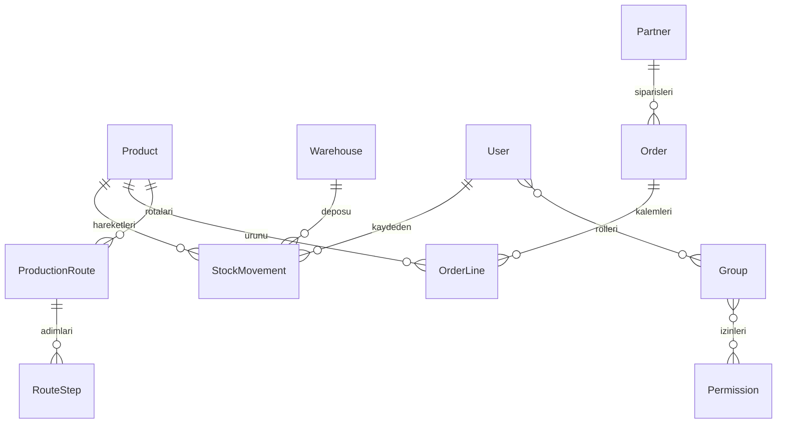

# Teknik yapı

## Neden bu teknolojiler?

Django 5.2 LTS, giriş, oturum, CSRF koruması, parola doğrulama, Türkçe yönetim ekranı ve kullanıcı/grup izinlerini birlikte sağlar. Sunucuda oluşturulan HTML ve sade CSS, ayrı bir ön yüz derleme zinciri gerektirmez. Mobil düzende menü yatay kayar; geniş tablolar kendi alanında kaydırılır. Para ve miktar alanlarında ondalık sayılar kullanılır; kayan nokta yuvarlama hatalarından kaçınılır.

## Veri tabanı

- Ürün: kod (benzersiz), ad, birim, asgari stok, aktiflik.
- Depo: benzersiz ad.
- Stok hareketi: ürün, depo, giriş/çıkış, pozitif miktar, açıklama, kullanıcı ve tarih.
- Cari: ad/unvan, müşteri/tedarikçi/ikisi, vergi no, iletişim ve adres.
- Sipariş: benzersiz numara, satış/satın alma, cari, tarih/teslim tarihi, durum, para birimi, not.
- Kalem: sipariş, ürün, pozitif miktar, negatif olmayan birim fiyat. Toplam miktar × fiyat olarak hesaplanır.
- Rota: ürün, ad, sürüm, aktiflik. Ürün/sürüm çifti benzersizdir.
- Adım: rota, benzersiz sıra, operasyon, istasyon, dakika ve talimat.

Django migration dosyaları şemayı sürümler. `migrate` var olan veri tabanına yalnızca uygulanmamış değişiklikleri uygular. `0001_initial.py` ilk şemadır. İş kayıtları için silme ekranı oluşturulmadı. İlişkiler `PROTECT` ile yanlışlıkla bağlı kayıt silinmesini engeller.

Stok miktarı hareketlerden hesaplanır. PostgreSQL'de aynı depoya yazan stok işlemleri depo satırı kilidi ve atomik işlem içinde doğrulanır. SQLite satır kilidi sağlamaz; yoğun eşzamanlı yazmalarda kilit hatası dönebilir. Arayüz bu durumda kullanıcıdan sonucu kontrol etmesini ister. Üretim öncesi PostgreSQL üzerinde eşzamanlı stok testi yapılmalıdır. ORM toplu güncelleme veya ham SQL, uygulama kurallarını atlayabilir; bu yollar kullanıcıya açılmaz.

Yetkiler hem liste hem ekleme/düzenleme uçlarında denetlenir. İlişkili kayıt seçimleri ilgili görüntüleme iznine tabidir. İş verileri Django yönetim ekranına kaydedilmez; bu ekran kullanıcı ve grup yönetimi içindir. Giriş denemesi sınırlaması, ayrıntılı değişiklik günlüğü, MFA ve parola sıfırlama e-postası bu ilk sürümün dışındadır.

## Dosyalar

- `config/settings.py`: ortam değişkenleri, veri tabanı ve güvenlik ayarları.
- `erp/models.py`: veri yapısı ve temel iş kuralları.
- `erp/views.py`: yetki kontrollü ekranlar ve formlar.
- `erp/registry.py`: modül listesi ve tablo sütunları.
- `erp/tests.py`: iş akışı ve yetki testleri.
- `templates/`, `static/`: Türkçe sayfalar ve uyarlanabilir tasarım.
- `scripts/setup.sh`, `scripts/start.sh`: tekrar kullanılabilir yerel kurulum/başlatma.

Yeni bir bulut görevi zaten yalıtılmıştır; mevcut `/workspace/yeni-erp` kopyasını kullanın. Kullanıcı özellikle istemedikçe Git worktree oluşturmayın. Canlı süreçlerin sonraki göreve taşınacağını varsaymayın; geliştirme sunucusunu tekrar başlatın. Kurulum ve başlatma betikleri veri silmez ve demo verisi eklemez.

## Üretim ve reçete eklemesi

`CatalogImport` dosya özetiyle yinelenen aktarımları önler. `MaterialRecipe` üst ürünü ve kaynak sürümünü, `MaterialRequirement` kaynak sayfa/satırını, özgün hücreleri, formülleri, nullable ihtiyaç miktarını ve inceleme notlarını tutar. Kod çelişkilerinde ürün kartı bağlantısı nullable bırakılır. `ProductionFlow` ve `ProductionFlowStep` standart akışları; `ProductionJob` ve `ProductionJobStep` iş emirleri, ön koşul işleri ve tarih/kullanıcı içeren ilerlemeyi saklar. Yeni migration mevcut iş verilerini silmeden şemayı genişletir.

Excel okuma `openpyxl` ve XML koruması `defusedxml` ile yapılır; formül veya makro çalıştırılmaz, dış bağlantılar izlenmez. Dosya/açılmış arşiv/satır boyutları sınırlandırılır. PostgreSQL'de iş ilerletme yalnızca iş emri satırını kilitler; nullable reçete dış birleşimine kilit uygulanmaz. SQLite yoğun eşzamanlı yazmalarda meşgul hatası verebilir; arayüz yeniden kontrol etmeyi söyler. Eski aşama belirteciyle gönderilen tekrar isteği yeni aşamayı tamamlamaz.

İşletme Excel'i ve gerçek veri tabanı GitHub'a eklenmez. Geliştirme veri tabanına yapılan aktarım, kodu başka bir makinede klonlayınca otomatik taşınmaz; yeni ortamda güvenli veri tabanı yedeği veya Excel aktarımı gerekir. Ayrıntılı davranış ve sınırlar [Üretim ve Excel rehberinde](uretim-ve-excel.md) açıklanır.

Kategori kuralları `erp/routing.py` içinde tutulur. Yeni döküm/ahşap kategorilerinde Mamul etiketli bileşenler de rota atamasına katılır. `erp/catalog.py` yalnızca bu kategorilerde Mamul/Yarı Mamul farkını eşleştirme açısından eşdeğer kabul eder; kaynak etiketleri ve mevcut kart türleri değişmez. Ürün ayrıntısı aynı kuralı kullanarak bu satırları yarı mamuller bölümünde gösterir. Önceki otomatik rotaların `rule_key` değeri korunmuştur; böylece tekrar çalıştırma rota veya adım çoğaltmaz. Bu genişletme veri tabanı şemasını değiştirmez. `erp/test_category_routes.py` kategori eşleşmelerini, tür istisnasını, kaynakların ve mevcut rotaların korunmasını, çelişkileri ve iş emri kullanımını sınar.

Izgara için rota doğrudan ana mamule atanır; `is_codeless_grill_material` yalnızca bu gruptaki kodsuz hammaddeyi beklenen kaynak yapısı olarak kabul eder. Tarihsel kaynak satırları ve notları yeniden yazılmaz. `erp/group_filters.py` bütün modül listeleri, ana panel ve raporlar için ortak grup ilişkilerini ve gerekli görüntüleme izinlerini tanımlar. Alt sorgular sipariş/akış gibi birden çok eşleşmesi olan kayıtları çoğaltmaz. `erp/products.py` ürün kartlarını kaynak grubunu da dikkate alarak sıralar; modelin genel sırası ve şema değiştirilmez. `erp/test_grill_filters.py` doğrudan Izgara üretimini, filtrelerin bütün modüllerde çalışmasını, izinleri, toplamları, sayfalamayı, sıralamayı ve gösterim hassasiyetini doğrular.

## Birlikte sipariş ve kalem girişi

`erp/orders.py` iki ekranın ortak ürün uygunluğu ve grup/seçenek verisini üretir. Satışta `main_products()` ilişkisi, satın almada `Product.kind='raw'` kullanılır. `erp/order_forms.py` başlık formunu ve mevcut `OrderLine` modeli üzerinde çalışan inline formset'i tanımlar. `erp/order_views.py` siparişi ve kalemlerini atomik kaydeder; bağımsız kalem ekranı da aynı seçim kuralını kullanır. Şema veya ayrı kalem tablosu eklenmez.

Ürün/tür uyumu `OrderLine.clean()` içinde de denetlenir. `Order.clean()` uyumsuz kalemle tür değiştirmeyi ve onaylamayı engeller. Başlık/kalem ekranları PostgreSQL'de aynı sipariş satırını kilitler; kalemler taslak durum doğrulanarak kaydedilir. Onaylı kalemi değiştirip siparişi aynı istekte taslağa alma girişimi reddedilir. Siparişe ait olmayan veya yinelenen gizli kalem kimlikleri formset tarafından reddedilir. Satır silme özelliği eklenmez. SQLite ve PostgreSQL'in eşzamanlılık farklarına ilişkin önceki sınırlar geçerlidir.

`static/order-entry.js` tür/sipariş seçimine göre `order_product_options` GET uç noktasından izin kontrollü ürün seçeneklerini alır. Eski yanıtlar yeni seçimin üzerine yazılmaz. Grup seçimi yalnızca seçenekleri daraltır; seçilmiş geçerli ürünleri silmez. Yeni satırlar tarayıcıda eklenip kaldırılabilir. Sunucu tarafındaki **Seçimi güncelle** işlemi aynı verilerle yeniden gösterim sağlar. Sayı hassasiyeti, fiyat ve stok davranışı değişmez.

`erp/test_order_entry.py` iki ekranın ortak kayıtlarını, tür kısıtlarını, atomik geri almayı, izinleri, gizli kimlik kontrollerini, onay kilidini, seçenek uç noktasını ve siparişe göre kalem listesini doğrular. Chromium ile sentetik ve ayrı test veritabanında tür/grup değişimi, yeni satırlar, iki ekrandan düzenleme, onay/taslak dönüşü, masaüstü ve mobil sayfa taşması ayrıca kontrol edildi.
