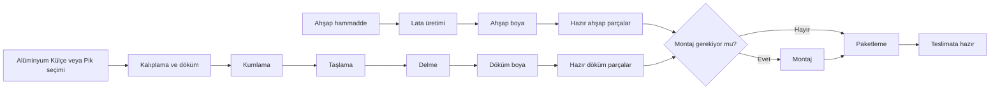

# Ahşap, döküm ve Excel reçeteleri

## Tanımlanan akışlar

İki üretim alanı vardır. Montaj ve teslimata hazırlık, ortak bitirme akışıdır.



Akışlar işletmenin tarif ettiği aşamalardır. Bir ürünün hangi alanda üretileceği, ahşap hammaddesinin türü/miktarı, operasyon süreleri ve montaj ihtiyacı Excel'de açıkça belirtilmiyorsa otomatik atanmaz. Standart akışlarda süreler boş bırakılır. Kompozit, beton veya diğer malzeme türleri ahşap/döküm olarak sınıflandırılmaz.

## Excel'i görmek ve aktarmak

Yönetici veya ERP yöneticisi hesabıyla **Excel aktarımları → Excel aktar** ekranını açın. En fazla 8 MB boyutunda `.xlsx` dosyası seçin. Sonuç ekranı satır sayısını, yeni kartları, boş alanları ve inceleme gerektiren satırları gösterir. Gözlemci ve üretim sorumlusu raporu okuyabilir; standart rollerde dosya aktarımı yalnızca ERP yöneticisine açıktır.

- Sayfalar sütun başlıklarına göre okunur. Bileşen kodu sütunu olmayan sayfalarda sonraki sütunlar kaydırılmaz.
- Boş kod, ad, miktar ve birimler boş kalır. Önceki satırdaki üst ürün kodu boş satıra kopyalanmaz. Kod, fire, süre, ürün birimi veya stok eşiği üretilmez.
- Sayfa adı ve gerçek Excel satırı saklanır. Özgün hücre değerleri (boşlar dahil) ve kaynak formüller ayrıca korunur.
- Formüller çalıştırılmaz. Excel'in kaydettiği hesaplanmış sonuç okunur; sonuç yoksa alan boş kalır ve rapora eklenir.
- Aynı dosya içeriği tekrar aktarılırsa yeni kart veya reçete satırı oluşturulmaz. Dosyanın adını değiştirmek bu kuralı değiştirmez.
- Aynı kodun farklı ad, tür veya birimle kullanılması sessizce birleştirilmez. Çelişki raporlanır; ilgili kart eşleştirilmez. Aynı adlı fakat farklı kodlu hammaddeler de otomatik birleştirilmez.
- Mevcut kartların ad/birim/diğer verileri aktarım sırasında değiştirilmez. Yeni dosya eski kartla çelişirse raporlanır. Gerekirse yetkili kullanıcı kartı ayrıca inceler.
- Kaynak reçete ve aktarım satırları ekran üzerinden değiştirilemez veya silinemez. Düzeltmeyi Excel'de yapıp yeni dosyayı aktarın. Farklı içerikli dosya yeni aktarım sürümü oluşturur; önceki sürüm korunur. İş emrinde doğru kaynak sürümünü seçin.

**Ürün reçeteleri → Ayrıntılar** ekranından üretim miktarını girerek ihtiyaç hesabını açın. Her satırın ihtiyacı `Excel'deki birim ihtiyaç × üretim miktarı` olarak hesaplanır. Boş miktar için sonuç gösterilmez. Farklı ölçü birimleri birbirine eklenmez. Dosyada üst ürüne bağlı verilen hammaddeler yarı mamullere tahminen dağıtılmaz; aynı malzeme iki kez tüketilmiş kabul edilmez. Üst ürünle bileşen kodu aynıysa döngüsel bir reçete oluşturulmaz; kaynak satır incelemeye ayrılır.

İlk sağlanan dosyada 24 sayfa ve 1.798 satır doğrulandı. 2.121 yeni kart ve 569 reçete oluşturuldu. 320 satır incelemeye ayrıldı; 72 boş ihtiyaç miktarı, 214 boş/eksik bileşen kodu, 5 boş bileşen adı, 4 boş üst ürün kodu ve 15 çelişkili kod var. Bu sayılar örtüşebilir; toplamları 320 olmak zorunda değildir. Kod/ad çelişkilerinin ayrıntıları uygulamanın aktarım raporundadır. İşletme verileri kaynak koduna veya GitHub'a eklenmez; mevcut veri tabanında saklanır.

## Üretim iş emri açma

1. **Üretim iş emirleri → Yeni kayıt** bölümünden iş emri numarasını, ürünü/yarı mamulü ve miktarı girin. Üretim birimini açıkça seçin. Kartın bilinen birimiyle farklı birim seçilemez.
2. **Ahşap üretimi**, **Döküm üretimi** veya **Montaj ve teslimata hazırlık** akışını seçin. Ürün kartına üretim alanı daha önce açıkça girilmişse uyumsuz akış engellenir.
3. Dökümde **Alüminyum Külçe** veya **Pik** seçimini kendiniz yapın. Reçetede farklı hammadde yazıyorsa seçim engellenir. Başka malzemeler bu ikisinden biri varsayılmaz.
4. Bir reçete seçerseniz aynı ürün kartına bağlı olmalıdır. Eksik/çelişkili reçeteyle iş başlatılamaz. Reçete seçmeden açılan iş açıkça **yalnızca aşama takibi** olarak gösterilir; malzeme ihtiyacı hesaplanmaz. Eksik veriyi doldurmak yerine aşama takibi seçildiğinin farkında olun.
5. Ortak bitirme akışında montaj gerekip gerekmediğini açıkça seçin. Gerekmiyorsa montaj atlanır; paketleme ve teslimata hazır aşamaları devam eder.
6. Gerekli ahşap ve döküm işlerini **Önce tamamlanacak işler** alanından bağlayın. Bu işler tamamlanmadan ortak bitirme başlatılamaz. Hangi işlerin bağlanacağı otomatik tahmin edilmez.
7. **İş emrini başlat** düğmesi aşama listesini oluşturur. Sonra yalnızca sıradaki aşamayı tamamlayın. Tamamlayan kullanıcı ve tarih kaydedilir. Eski sayfadan gönderilen veya tekrarlanan tıklama sonraki aşamayı atlatmaz.

Başlatılan işin ürün/miktar/akış tanımı ekran üzerinden değiştirilemez. Sonraki akış değişiklikleri önceden başlatılan işin aşamalarını değiştirmez. Gözlemci aşama ilerletemez; üretim sorumlusu ve ERP yöneticisi ilerletebilir.

**Bu sürüm otomatik stok düşümü, stok rezervasyonu, sevkiyat veya muhasebe yapmaz.** Gerçek stok hareketlerini belge numarasıyla ayrıca kaydedin. Birimi boş ürünle stok hareketi kaydetmek engellenir; birimi kartta yetkili kişi açıkça tanımlamalıdır. Paketleme/teslimata hazır aşamasının tamamlanması fiziksel teslimat yapıldığı anlamına gelmez.

## Terminalden kurulum ve kontrol

```bash
cd /workspace/yeni-erp
bash scripts/setup.sh
.venv/bin/python manage.py test --verbosity 2
```

Kurulum yeni tabloları ekler, rollerin yeni izinlerini tamamlar ve eksik standart akışları kurar. Var olan akışlar/süreler üzerine yazılmaz. `setup_production` ve `setup_roles` tekrar çalıştırılabilir.

İlk aktarımı veya dosya denetimini terminalden yapmak için kendi dosyanızın gerçek yolunu kullanın:

```bash
.venv/bin/python manage.py import_catalog /dosyanin/gercek/yolu.xlsx --check
.venv/bin/python manage.py import_catalog /dosyanin/gercek/yolu.xlsx
```

`--check` dosyayı okur, veri tabanına yazmaz. Normal aktarım atomik yapılır; başarısız olursa o aktarımın oluşturduğu kayıtlar kısmen bırakılmaz. Önceden kaydedilmiş veriler silinmez.

Testler sentetik küçük Excel dosyaları oluşturur; işletmenin Excel'i depoya test dosyası olarak eklenmez. İlk dosyanın tüm 1.798 satırındaki özgün hücreler ayrıca veri tabanıyla karşılaştırılarak doğrulandı. SQLite üzerinde test edildi; PostgreSQL'de kilitleme/eşzamanlı yük doğrulaması ve gerçek cihaz testi ayrıca yapılmalıdır.

## Bu değişiklikte yapılan doğrulamalar

- 47 otomatik test: eski işlevler, başlığa göre Excel okuma, boşları koruma, dosya tekrarı, formülleri çalıştırmama, kod çelişkileri, mevcut kartları koruma, miktar hesabı, yetkiler, üretim sırası, açık hammadde seçimi, isteğe bağlı montaj, bağlı işlerin tamamlanması, eski/tekrarlanan istekler ve başlatılmış işin kilidi.
- Gerçek Excel'in 1.798 satırındaki kaynak değerler veri tabanındaki özgün değerlerle karşılaştırıldı; eksik miktar/kodların boş kaldığı doğrulandı.
- Aynı dosyanın yeniden aktarımında `created=false` döndü; kayıtlar çoğalmadı.
- Önceden bulunan kullanıcı ve iş kayıtları değişiklik öncesi yedekle karşılaştırıldı; korundukları doğrulandı.
- Gerçek aktarım üzerinde ana panel, listeler, rapor, ihtiyaç hesabı ve üç üretim akışı ekranı oluşturuldu; yanıtlar başarılı.
- PostgreSQL eşzamanlı yük ve gerçek mobil tarayıcı testi yapılmadı. GitHub Actions sonucu yerel test sonucu olarak sunulmaz.
