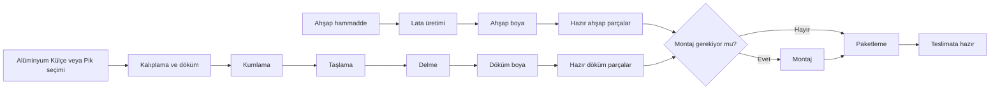

# Ahşap, döküm ve Excel reçeteleri

## Tanımlanan akışlar

İki üretim alanı vardır. Montaj ve teslimata hazırlık, ortak bitirme akışıdır.



Akışlar işletmenin tarif ettiği aşamalardır. Bir ürünün hangi alanda üretileceği, ahşap hammaddesinin türü/miktarı, operasyon süreleri ve montaj ihtiyacı Excel'de veya işletmenin açıkça belirlediği rota kurallarında belirtilmiyorsa otomatik atanmaz. Standart akışlarda süreler boş bırakılır. Kompozit, beton veya diğer malzeme türleri ahşap/döküm olarak sınıflandırılmaz.

## Excel'i görmek ve aktarmak

Yönetici veya ERP yöneticisi hesabıyla **Excel aktarımları → Excel aktar** ekranını açın. En fazla 8 MB boyutunda `.xlsx` dosyası seçin. Sonuç ekranı satır sayısını, yeni kartları, boş alanları ve inceleme gerektiren satırları gösterir. Gözlemci ve üretim sorumlusu raporu okuyabilir; standart rollerde dosya aktarımı yalnızca ERP yöneticisine açıktır.

- Sayfalar sütun başlıklarına göre okunur. Bileşen kodu sütunu olmayan sayfalarda sonraki sütunlar kaydırılmaz.
- Boş kod, ad, miktar ve birimler boş kalır. Önceki satırdaki üst ürün kodu boş satıra kopyalanmaz. Kod, fire, süre, ürün birimi veya stok eşiği üretilmez.
- Sayfa adı ve gerçek Excel satırı saklanır. Özgün hücre değerleri (boşlar dahil) ve kaynak formüller ayrıca korunur.
- Formüller çalıştırılmaz. Excel'in kaydettiği hesaplanmış sonuç okunur; sonuç yoksa alan boş kalır ve rapora eklenir.
- Aynı dosya içeriği tekrar aktarılırsa yeni kart veya reçete satırı oluşturulmaz. Dosyanın adını değiştirmek bu kuralı değiştirmez.
- Aynı kodun farklı ad, tür veya birimle kullanılması sessizce birleştirilmez. Çelişki raporlanır; ilgili kart eşleştirilmez. Aşağıdaki yeni kategori kurallarında **Mamul / Yarı Mamul** etiketleri eşdeğerdir; bu sınırlı istisnada kaynak etiketleri korunarak aynı kart eşleştirilebilir. Aynı adlı fakat farklı kodlu hammaddeler de otomatik birleştirilmez.
- Mevcut kartların ad/birim/diğer verileri aktarım sırasında değiştirilmez. Yeni dosya eski kartla çelişirse raporlanır. Gerekirse yetkili kullanıcı kartı ayrıca inceler.
- Kaynak reçete ve aktarım satırları ekran üzerinden değiştirilemez veya silinemez. Düzeltmeyi Excel'de yapıp yeni dosyayı aktarın. Farklı içerikli dosya yeni aktarım sürümü oluşturur; önceki sürüm korunur. İş emrinde doğru kaynak sürümünü seçin.

**Ürün reçeteleri → Ayrıntılar** ekranından üretim miktarını girerek ihtiyaç hesabını açın. Her satırın ihtiyacı `Excel'deki birim ihtiyaç × üretim miktarı` olarak hesaplanır. Boş miktar için sonuç gösterilmez. Farklı ölçü birimleri birbirine eklenmez. Dosyada üst ürüne bağlı verilen hammaddeler yarı mamullere tahminen dağıtılmaz; aynı malzeme iki kez tüketilmiş kabul edilmez. Üst ürünle bileşen kodu aynıysa döngüsel bir reçete oluşturulmaz; kaynak satır incelemeye ayrılır.

İlk sağlanan dosyada 24 sayfa ve 1.798 satır doğrulandı. 2.121 yeni kart ve 569 reçete oluşturuldu. 320 satır incelemeye ayrıldı; 72 boş ihtiyaç miktarı, 214 boş/eksik bileşen kodu, 5 boş bileşen adı, 4 boş üst ürün kodu ve 15 çelişkili kod var. Bu sayılar örtüşebilir; toplamları 320 olmak zorunda değildir. Kod/ad çelişkilerinin ayrıntıları uygulamanın aktarım raporundadır. İşletme verileri kaynak koduna veya GitHub'a eklenmez; mevcut veri tabanında saklanır.

## Üretim iş emri açma

1. **Üretim iş emirleri → Yeni kayıt** bölümünden iş emri numarasını, ürünü/yarı mamulü ve miktarı girin. Üretim birimini açıkça seçin. Kartın bilinen birimiyle farklı birim seçilemez.
2. **Ahşap üretimi**, **Döküm üretimi** veya **Montaj ve teslimata hazırlık** akışını seçin. Ürün kartına üretim alanı daha önce açıkça girilmişse uyumsuz akış engellenir.
3. Dökümde **Alüminyum Külçe** veya **Pik** seçimini kendiniz yapın. Reçetede farklı hammadde yazıyorsa seçim engellenir. Başka malzemeler bu ikisinden biri varsayılmaz.
4. Bir reçete seçerseniz aynı ürün kartına bağlı olmalıdır. Eksik/çelişkili reçeteyle iş başlatılamaz. Reçete seçmeden açılan iş açıkça **yalnızca aşama takibi** olarak gösterilir; malzeme ihtiyacı hesaplanmaz. Eksik veriyi doldurmak yerine aşama takibi seçildiğinin farkında olun.
5. Ortak bitirme akışında montaj gerekip gerekmediğini açıkça seçin. Gerekmiyorsa montaj atlanır; paketleme ve teslimata hazır aşamaları devam eder.
6. Gerekli ahşap ve döküm işlerini **Önce tamamlanacak işler** alanından bağlayın. Bu işler tamamlanmadan ortak bitirme başlatılamaz. Hangi işlerin bağlanacağı otomatik tahmin edilmez.
7. **İş emrini başlat** düğmesi aşama listesini oluşturur. Sonra yalnızca sıradaki aşamayı tamamlayın. Tamamlayan kullanıcı ve tarih kaydedilir. Eski sayfadan gönderilen veya tekrarlanan tıklama sonraki aşamayı atlatmaz.

Başlatılan işin ürün/miktar/akış tanımı ekran üzerinden değiştirilemez. Sonraki akış değişiklikleri önceden başlatılan işin aşamalarını değiştirmez. Gözlemci aşama ilerletemez; üretim sorumlusu ve ERP yöneticisi ilerletebilir.

Yeni **Üretim ve stok** işleri, son aşamada doğrulanmış doğrudan tüketim reçetesiyle stok düşer ve ürün girişi oluşturur. Eski **Yalnız aşama takibi** işleri stok değiştirmez. Stok rezervasyonu, otomatik sevkiyat ve muhasebe henüz yoktur. Açılış stoğunu ve üretim dışı gerçek hareketleri ayrıca kaydedin. Birimi boş ürünle stok hareketi kaydetmek engellenir; birimi kartta yetkili kişi açıkça tanımlamalıdır. Paketleme/teslimata hazır aşamasının tamamlanması fiziksel teslimat yapıldığı anlamına gelmez.

## Terminalden kurulum ve kontrol

```bash
cd /workspace/yeni-erp
bash scripts/setup.sh
.venv/bin/python manage.py test --verbosity 2
```

Kurulum yeni tabloları ekler, rollerin yeni izinlerini tamamlar ve eksik standart akışları kurar. Var olan akışlar/süreler üzerine yazılmaz. `setup_production` ve `setup_roles` tekrar çalıştırılabilir.

İlk aktarımı veya dosya denetimini terminalden yapmak için kendi dosyanızın gerçek yolunu kullanın:

```bash
.venv/bin/python manage.py import_catalog /dosyanin/gercek/yolu.xlsx --check
.venv/bin/python manage.py import_catalog /dosyanin/gercek/yolu.xlsx
```

`--check` dosyayı okur, veri tabanına yazmaz. Normal aktarım atomik yapılır; başarısız olursa o aktarımın oluşturduğu kayıtlar kısmen bırakılmaz. Önceden kaydedilmiş veriler silinmez.

Testler sentetik küçük Excel dosyaları oluşturur; işletmenin Excel'i depoya test dosyası olarak eklenmez. İlk dosyanın tüm 1.798 satırındaki özgün hücreler ayrıca veri tabanıyla karşılaştırılarak doğrulandı. SQLite üzerinde test edildi; PostgreSQL'de kilitleme/eşzamanlı yük doğrulaması ve gerçek cihaz testi ayrıca yapılmalıdır.

## Bu değişiklikte yapılan doğrulamalar

- 47 otomatik test: eski işlevler, başlığa göre Excel okuma, boşları koruma, dosya tekrarı, formülleri çalıştırmama, kod çelişkileri, mevcut kartları koruma, miktar hesabı, yetkiler, üretim sırası, açık hammadde seçimi, isteğe bağlı montaj, bağlı işlerin tamamlanması, eski/tekrarlanan istekler ve başlatılmış işin kilidi.
- Gerçek Excel'in 1.798 satırındaki kaynak değerler veri tabanındaki özgün değerlerle karşılaştırıldı; eksik miktar/kodların boş kaldığı doğrulandı.
- Aynı dosyanın yeniden aktarımında `created=false` döndü; kayıtlar çoğalmadı.
- Önceden bulunan kullanıcı ve iş kayıtları değişiklik öncesi yedekle karşılaştırıldı; korundukları doğrulandı.
- Gerçek aktarım üzerinde ana panel, listeler, rapor, ihtiyaç hesabı ve üç üretim akışı ekranı oluşturuldu; yanıtlar başarılı.
- PostgreSQL eşzamanlı yük ve gerçek mobil tarayıcı testi yapılmadı. GitHub Actions sonucu yerel test sonucu olarak sunulmaz.


## Çeşme ve park bahçe bankı yarı mamul rotaları

İşletmenin verdiği kurallar artık yarı mamul kartlarına uygulanır:

| Kategori / yarı mamul | Temin yöntemi | Rota |
| --- | --- | --- |
| Çeşmelerde tüm yarı mamuller | İç üretim | Döküm |
| Banklarda Taşıyıcı Ayak ve Gövde | İç üretim | Döküm |
| Banklarda Ahşap Bölüm | İç üretim | Ahşap |
| Banklardaki diğer adı belli yarı mamuller | Dışarıdan hazır temin | Dışarıdan hazır temin |

Kural yalnızca bu kategorilerin **Yarı Mamul** satırlarına uygulanır. Hammaddeler, ana ürünler ve diğer kategoriler bu işlemle sınıflandırılmaz. Bank yarı mamulünün adı boşsa hazır temin olduğu varsayılmaz. Çeşmelerde Pirinç Musluk gibi adlar da işletmenin “tüm yarı mamuller döküm” kuralına dahildir; adından farklı temin yolu tahmin edilmez.

**Ürün kartları → Ana ürün → Yarı mamuller ve hammaddeler → Üretim / temin rotası** yolundan adımları açabilirsiniz. Menüdeki **Üretim ve temin rotaları** ekranı tüm tanımlı rotaları listeler. Döküm/ahşap rotası ekranındaki **Bu rotayla iş emri aç** bağlantısı ürün, rota, akış ve kartın bilinen birimini seçer. İş emri numarası, üretim miktarı ve döküm hammaddesi kullanıcı tarafından girilir.

Tek bir uygun etkin iç üretim rotası varsa, iş emri başlatıldığında bu rota otomatik seçilir. Birden fazla uygun rota varsa hangisinin kullanılacağı açıkça seçilmelidir. Farklı ürüne ait, pasif, hazır temin veya seçilen akışla uyuşmayan rota üretim işinde kullanılamaz. Başlatılan işin adımları rotadan kopyalanır; sonraki rota düzenlemeleri başlamış işin geçmişini değiştirmez.

Hazır temin parçalarına döküm/ahşap aşaması eklenmez. Bu rotalar bir üretim işi veya satın alma siparişi başlatmaz; miktar, tedarikçi, fiyat ve teslim süresi ayrıca belirlenir. Gerekirse ayrı ortak bitirme akışıyla paketleme takip edilebilir. Stok hareketleri hâlâ ayrıca kaydedilir.

Yeni Excel aktarımında bu kurallara uyan yarı mamullerin rotaları da oluşturulur. Aynı kartın birden fazla reçetede kullanılması ikinci bir rota oluşturmaz. Kuralları mevcut katalog üzerinde tekrar uygulamak için:

```bash
.venv/bin/python manage.py setup_component_routes
```

Komut mevcut rotaları/adımları, elle girilmiş süreleri veya çelişen mevcut üretim/temin tanımlarını ezmez; çelişkileri raporlar. Kartın farklı kategorilerde çelişkili rotalara bağlanması durumunda seçim yapmaz. Önceden elle oluşturulmuş rotalar korunur; gerektiğinde yeni sürüm oluşturulur. `scripts/setup.sh` bu adımı da içerir. Süreler ve hammadde miktarları bu kurallarla doldurulmaz.

## Diğer kategorilerin üretim rotaları

30 Ekim 2026'da belirtilen kurallar, önceki çeşme ve bank kuralları korunarak eklendi:

| Kategori | Reçete bileşeni | Üretim rotası |
| --- | --- | --- |
| Şömineler | Tüm yarı mamuller | Döküm |
| Izgara / Izgaralar | Doğrudan ana mamul; yarı mamul yok | Döküm |
| Posta kutusu | Tüm yarı mamuller | Döküm |
| Soba | Tüm yarı mamuller | Döküm |
| Sandalye | Tüm yarı mamuller | Döküm |
| Kapak | Tüm yarı mamuller | Döküm |
| Bariyer | Tüm yarı mamuller | Döküm |
| Ferforje korkuluk | Tüm yarı mamuller | Döküm |
| Masa, Masa ayakları, Masa ve masa ayakları | Tüm yarı mamuller | Döküm |
| Mangal | Ahşap saplı kulp, Tel ızgara sapı | Ahşap |
| Mangal | Diğer adı belli yarı mamuller | Döküm |
| Döküm saksı | Tüm yarı mamuller | Döküm |
| Ahşap saksı | Tüm yarı mamuller | Ahşap |

Izgara dışındaki bu yeni kategorilerde **Mamul** etiketli reçete bileşenleri de **Yarı mamuller** bölümünde gösterilir ve aynı kurallarla rota alır. Kaynak tür etiketi, özgün hücreler ve mevcut kart türü değiştirilmez. Aynı bileşen kodu bir satırda Mamul, diğerinde Yarı Mamul olarak verilmişse ad ve birim uyumlu olduğunda aynı karta bağlanır. Ad, birim veya hammadde/parça türü uyuşmazlıkları bu istisnaya girmez. Çeşme ve bankların önceki Mamul yorumlaması değişmez.

**Izgara** tek mamulden oluşur. Döküm rotası, reçetenin bağlı olduğu ana ürün kartına veya Izgara grubunda elle açılmış bağımsız ana ürün kartına atanır. Bu gruba özel yarı mamul oluşturulmaz ve hammadde satırları yarı mamule dönüştürülmez. Bileşen kodu sütunu veya kod değeri boş olabilir. Kodsuz hammadde satırında bu boşluk eşleştirme hatası sayılmaz; ad, miktar ve ölçü birimi incelemesi devam eder. Önceki aktarımın özgün boş hücreleri ve inceleme notları saklanır; yalnızca bu beklenen boş koda ait uyarı güncel ihtiyaç hesabında ve inceleme görünümünde hata olarak gösterilmez. Kayıtlı hammadde adı ve miktarı üzerinden ihtiyaç hesaplanabilir; bu durum stok kartı veya stok hareketi oluşturmaz.

Kategori eşleştirmesi Excel sayfa adına göre yapılır; tanımlı tekil/çoğul adlar, büyük/küçük harf ve fazla boşluk farklılıkları desteklenir. Örneğin Izgara/Izgaralar, Soba/Sobalar, Masa/Masalar, Döküm saksı/Döküm saksılar aynı kurala bağlanır. Mangalın ahşap istisnaları bileşen adının tamamına göre belirlenir; **Tel ızgara**, **Tel ızgara sapı** ile aynı bileşen sayılmaz. Adı boş Mangal bileşeninde üretim alanı tahmin edilmez; komut raporunda incelemeye bırakılır.

Izgara ana mamulü istisnası dışındaki üst ürünlere, hammaddelere, parçalara veya bu kuralların dışındaki kategorilere yeni rota atanmaz. Aynı kod hem üst ürün hem kendi bileşeni olarak verilmişse kendine bağlı rota oluşturulmaz. Kart başka bir üründe bileşen olarak kullanılıyorsa o gerçek bileşen ilişkisi değerlendirilebilir. Bir kart için ahşap ve döküm gibi çelişkili kurallar çıkarsa mevcut atama korunur; yeni seçim yapılmaz ve `setup_component_routes` çıktısındaki `skipped` listesinde açıklanır.

Yeni Excel aktarımlarında kurallar otomatik uygulanır. Önceden aktarılmış ve kart bağlantısı bulunan satırlar için aynı `setup_component_routes` komutunu kullanın. Aynı dosyayı yeniden yüklemek aktarımı tekrarlamaz. Önceden çelişki nedeniyle kart bağlantısı boş bırakılmış kaynak satırları bu komutla yeniden yazılmaz; bu kayıtlar ayrıca incelenmelidir. Mevcut rotalar, adımlar, süreler ve başlatılmış iş emirleri korunur; bilinmeyen süre veya malzeme miktarı eklenmez.

## Ürün grubu filtresi ve ihtiyaç gösterimi

Ana panelde ve tüm modül listelerinde **Ürün grubu → Filtrele** ile gruba göre süzün. Arama ile birlikte kullanılabilir; liste sayfası değiştiğinde iki seçim de korunur. Ürün kartlarında sıralama grup, ardından ürün kodudur. Kaynak reçete grubu bulunan boş kategori kartı da o grup altında sıralanır; çok gruplu kartta alfabetik ilk grup kullanılır.

Stok, rota, rota adımı ve iş emirleri bağlı ürüne; siparişler ve cariler sipariş kalemlerine; depolar stok hareketlerine göre seçilir. Akışlar ilişkili rota ve iş emirlerine, Excel aktarımları kaynak reçete ve satırlarına göre süzülür. Kod eşleştirmesi olmayan reçete satırları kaynak sayfa grubuyla bulunur. **Grubu belirtilmeyenler**, hiçbir ürün grubu ilişkisi bulunmayan kayıtları seçer. Karma gruplu sipariş seçilen gruptan en az bir kalemi varsa bir kez görünür; toplamı tüm kalemleri kapsar. Ürünle ortak kullanılan bir bileşen birden fazla grubun filtresinde bulunabilir.

Dolaylı filtreler için ilişkili kayıtları görüntüleme izinleri gerekir; izin yoksa kontrol pasif olur ve doğrudan filtre isteği reddedilir. Ana panelde seçilen gruba göre hesaplanamayan, yetkisiz ilişkilere ait özet gösterilmez.

Excel aktarım raporunun satır, sayfa ve güncel inceleme sayıları seçilen gruba göre hesaplanır; boş alan ve kod çelişkisi bölümleri de aynı gruba aittir. Yeni ürün kartı sayısı yalnızca aktarımın tamamında gösterilir, çünkü geçmiş kartların hangi aktarımda oluşturulduğu kart bazında tutulmaz. İhtiyaç hesabında üretim miktarı ve ürün grubu seçimleri korunur.

**Reçete satırları ve eksikler** listesindeki **Bir üst ürün için ihtiyaç** sütununda Adet ondalıksız, diğer birimler iki basamakla gösterilir. Kesirli Adet kaynağı varsa özgün değer inceleme uyarısıyla gösterilir; sessizce yuvarlanmaz. Örneğin `2`, `12,35`, `7,00`; bilinmeyen miktar `—` olarak kalır. Yuvarlama yalnızca gösterimi etkiler; hesaplama ve kaynak hassasiyeti korunur. Ürün ayrıntısı ve ihtiyaç hesabındaki önceki üç basamaklı gösterim devam eder.


## Üretim ve stok bağlantısı

1. **Ürün kartlarında** çıktı ve girdilerin birimlerini açıkça tanımlayın. Adet miktarları tam sayı olmalıdır. **Stok hareketleri** ekranında açılış stoğunu doğru depoya girin.
2. **Stok tüketim reçeteleri → Yeni kayıt** yoluyla bir yarı mamul veya mamul için reçete oluşturun. Alternatif olarak kaynak **Ürün reçeteleri → Ayrıntılar → Stok tüketim kopyası oluştur** düğmesini kullanın. Kaynak Excel satırları ve kodları korunur.
3. **Girdi ekle** veya **Eşleştir / düzenle** ile bir çıktı için doğrudan tüketilecek stok kartlarını, miktar ve birimi tanımlayın. Izgara'nın kodsuz hammaddesini mevcut hammadde kartına burada bağlayın. Üst ürünün düz Excel tablosunda yer alsa bile bu üretimde doğrudan tüketilmeyen satırın **Bu üretimde tüketilir** seçimini kaldırın. Üst ürüne verilen hammaddenin yarı mamullere dağılımı bilinmiyorsa tahmin etmeyin; her yarı mamulün gerçek tüketimini ayrıca tanımlayın.
4. Reçete başlığını düzenleyip **Girdiler bu ürünün doğrudan tüketimidir** seçimini işaretleyerek doğrulayın. Eksik kart, miktar veya uyuşmayan birim varsa doğrulama reddedilir. Girdi değişince yeniden doğrulama gerekir. Kullanılmış sürümü değiştirmek yerine yeni sürüm açın.
5. **Üretim iş emrinde** **Üretim ve stok**, tüketim reçetesi, **Girdi çıkış deposu** ve **Ürün giriş deposu** seçin. İş başlatıldığında tüketim kopyası işe sabitlenir. Dökümde Pik/Alüminyum seçimi, rota ve önceki iş kontrolleri devam eder.
6. Son aşamada **Gerçekleşen üretim miktarı** girin. Fiili miktar planlanandan farklı olabilir; Adet için kesir girilemez. Girdi çıkışları ve ürün girişi tek işlemde kaydedilir. **Üretim stok fişleri** ekranında kullanıcı, zaman, depolar ve tüm hareketler görünür. Aynı işi yeniden tamamlamak ikinci stok işlemi oluşturmaz.

Örnek: bir yarı mamul için 5 kg hammadde gerekiyorsa 3 adet yarı mamul üretiminde 15 kg hammadde çıkar, 3 adet yarı mamul girer. Bir mamul 2 adet bu yarı mamulü ve 0,5 kg boyayı kullanıyorsa 1 mamul üretiminde 2 adet yarı mamul ve 0,5 kg boya çıkar, 1 adet mamul girer. Yarı mamulün hammaddesi mamul üretiminde tekrar tüketilmez. Bunu sağlamak için mamul tüketim reçetesine yalnız doğrudan girdilerini koyun.

Yetersiz stok, eksik eşleştirme veya birim değişiminde son aşama açık kalır; hiçbir kısmi hareket kaydedilmez. Açılış stoğunu veya gerçek eksiği tamamlayıp aynı aşamayı yeniden deneyin. Tüketim yanlış tanımlanmışsa başlamış işin kopyası değiştirilmez; doğru yeni sürümle yeni iş açın. Tamamlanmış stok fişi düzenlenmez/silinmez; düzeltme gerektiğinde yetkili kişi açıklamalı ters stok hareketi girer.

Önceki işlerin modları ve tamamlanma bilgileri korunur; geriye dönük stok düşülmez. Yeni yalnız paketleme/aşama takibi için **Yalnız aşama takibi** seçimi özel yetki gerektirir. Üretim sorumlusu stok fişi oluşturabilir, elle stok ekleme/çıkarma yetkisini ayrıca almalıdır.

## Miktar incelemesi ve işlem geçmişi

Adet miktarları sipariş, asgari stok, üretim, stok hareketi ve yeni tüketim reçetesinde tam sayıdır. Diğer ölçü birimleri ve fiyatlar kesirli kalır. Excel'de veya geçmiş kayıtlarda kesirli Adet bulunursa özgün miktar silinmez ve yuvarlanmaz; **Miktar incelemeleri** ekranında izlenir. Kaynak veriyi düzeltmek için yeni Excel sürümü aktarın. Kaynağın ayrı tüketim kopyasında gerçek tam sayı tüketimini yetkili kişi tanımlayıp doğrular.

**İşlem geçmişi**, ERP iş kayıtlarının yeni ekleme, düzenleme, silme ve iptal olaylarında kullanıcı/zaman ve eski/yeni değerleri tutar. Geçmiş kayıtlar için bilinmeyen kullanıcı ve eski işlem tarihi üretilmez. İzinli ERP yöneticisi ayrıntıları okuyabilir. Kullanıcı belirtilmeyen komutlar **Sistem / komut** olarak görünür. Sipariş kalemini iptal ederken taslak siparişte **İptal et** bağlantısını kullanın ve gerekçe girin; kalem siparişte geçmiş olarak kalır, toplama katılmaz.
